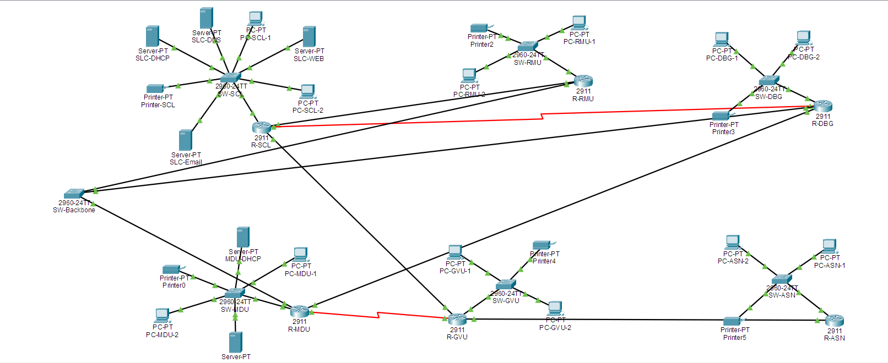
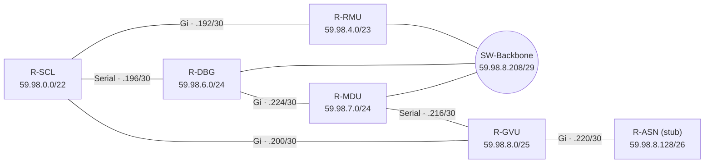
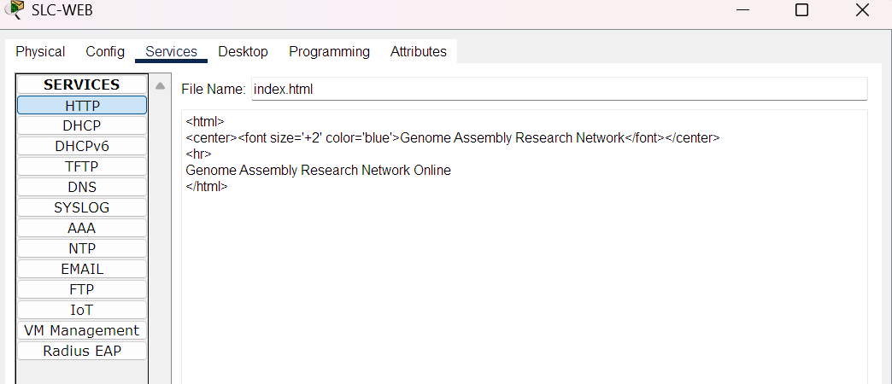
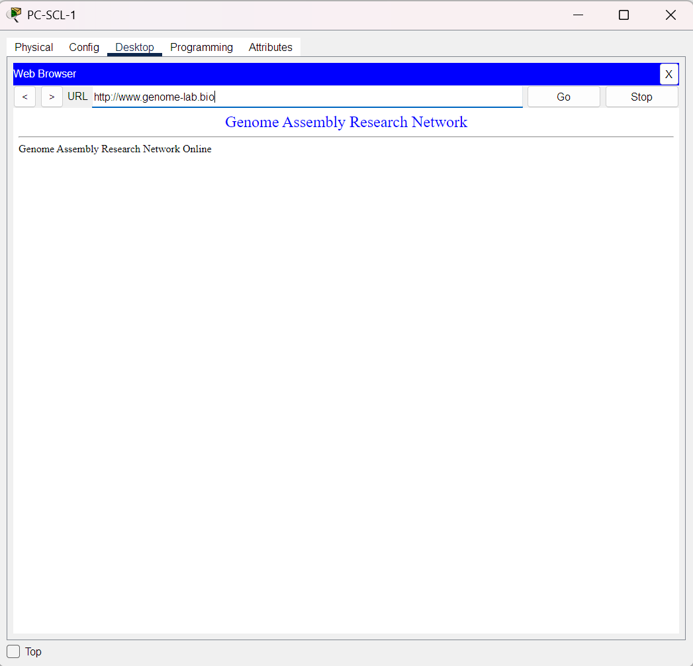
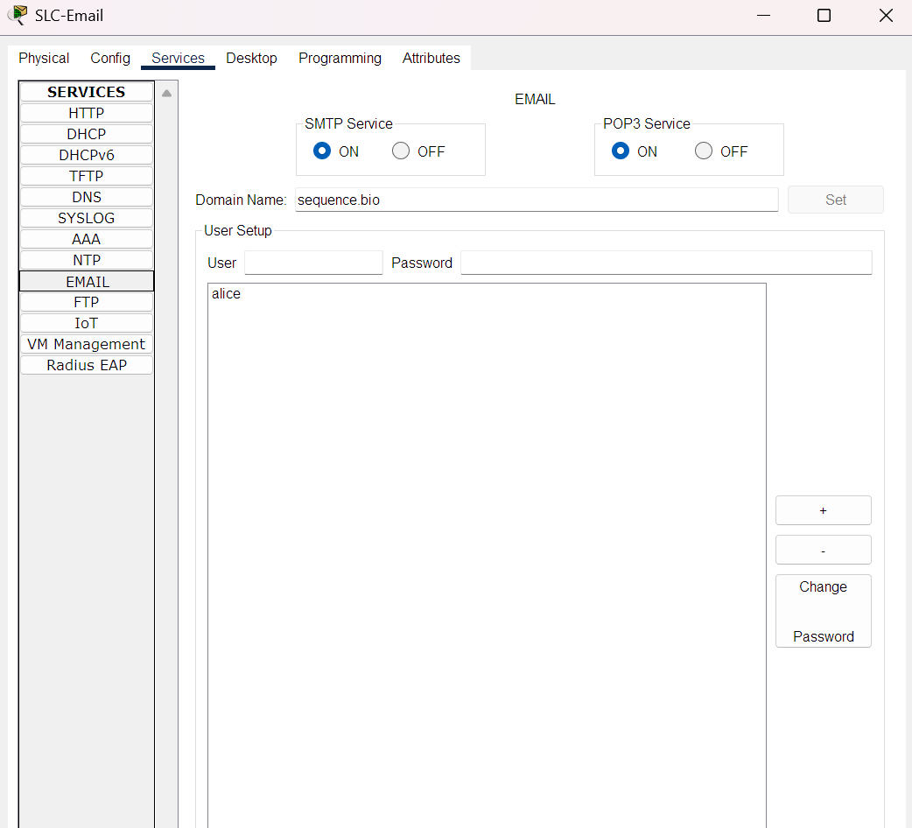
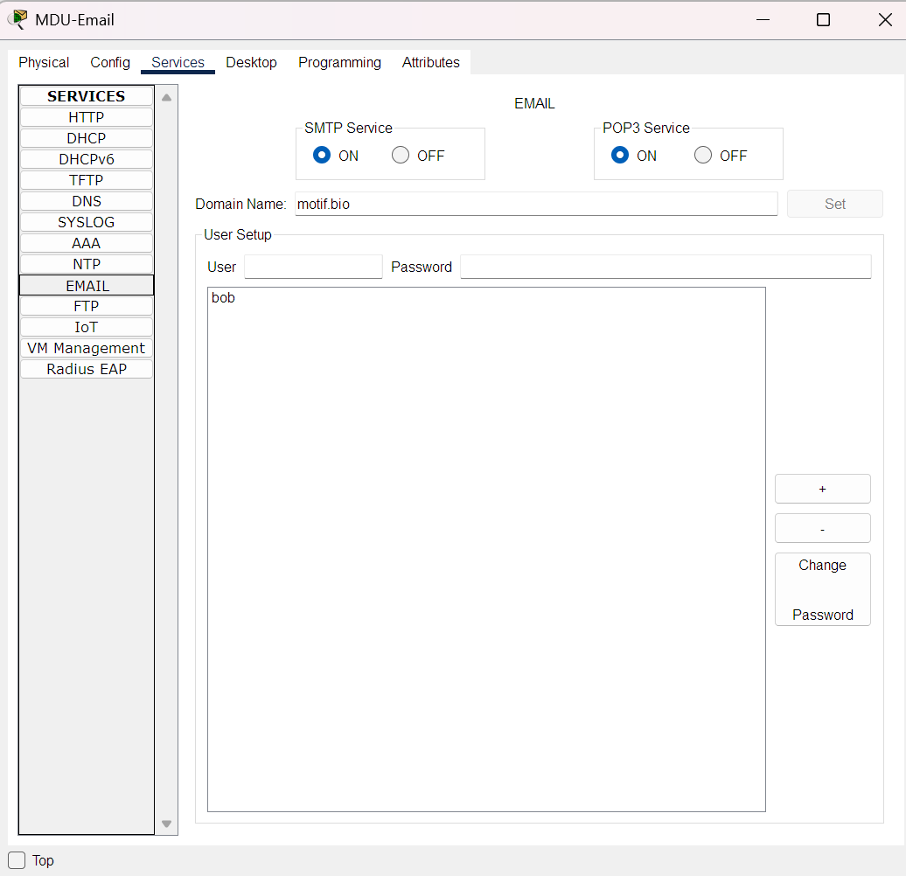
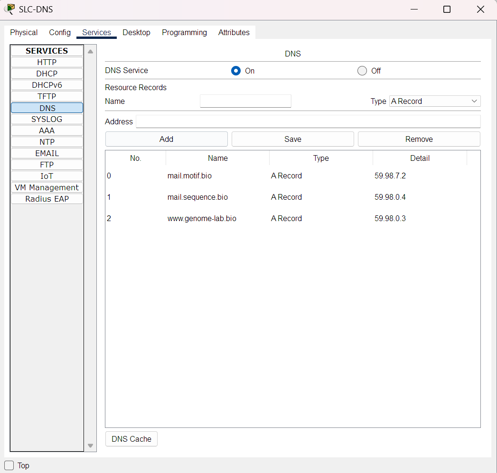
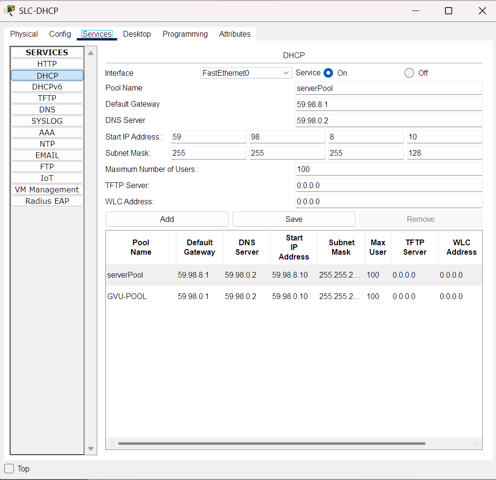
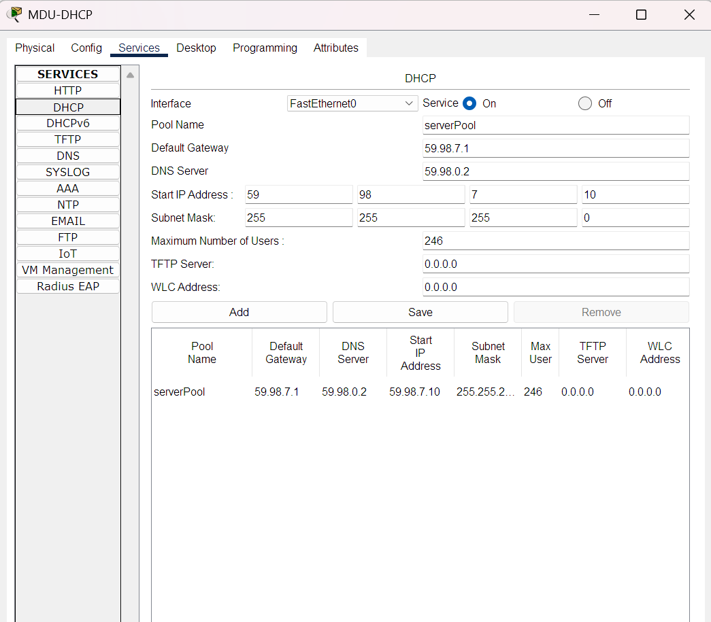

# Genome Assembly Research Network

A multi-site enterprise network for a fictional genome research organisation, designed and simulated in **Cisco Packet Tracer 8.2**. Six research units sit on their own LANs. They are connected through a mixed Ethernet/serial WAN, addressed with **VLSM** and routed with **RIPv2 plus static routes**. Shared services include DNS, web, email and DHCP.


## Highlights

- **VLSM addressing** of `59.98.0.0`, with LANs allocated from largest (/22) to smallest (/26) and WAN links on /30 and /29
- **Four host-addressing methods in one network**: router-based DHCP, a central DHCP server reached through a **DHCP relay** (`ip helper-address`), a local DHCP server, and static addressing
- **Dynamic + static routing**: RIPv2 (`no auto-summary`), a **floating static backup route** (AD 123), and **static route redistribution** into RIP for a stub network
- **Mixed WAN**: Gigabit Ethernet point-to-point links, a shared multi-access backbone segment, and two serial links
- **Network services**: DNS (`www.genome-lab.bio`), web server, two email domains (`sequence.bio`, `motif.bio`)
- **Troubleshooting write-up**: issues found by reviewing configs and server logs, with the root cause and fix for each ([see below](#troubleshooting--review-findings))

## Topology



*Packet Tracer topology. Red zig-zag lines are the serial links (R-SCL–R-DBG and R-MDU–R-GVU).*

Logical view:



**Devices:** 6 × Cisco 2911 routers, 7 × Catalyst 2960 switches (one per unit plus a backbone), 12 PCs, 6 printers, 6 servers.

## IP Addressing (VLSM)

### Unit LANs

| Unit | Network | Mask | Usable hosts | Gateway | Host addressing |
|---|---|---|---|---|---|
| SCL | 59.98.0.0/22 | 255.255.252.0 | 1022 | 59.98.0.1 | Central DHCP server `SLC-DHCP` (59.98.0.5) via `ip helper-address` |
| RMU | 59.98.4.0/23 | 255.255.254.0 | 510 | 59.98.4.1 | DHCP pool on R-RMU |
| DBG | 59.98.6.0/24 | 255.255.255.0 | 254 | 59.98.6.1 | DHCP pool on R-DBG |
| MDU | 59.98.7.0/24 | 255.255.255.0 | 254 | 59.98.7.1 | Local DHCP server `MDU-DHCP` (59.98.7.3) |
| GVU | 59.98.8.0/25 | 255.255.255.128 | 126 | 59.98.8.1 | `SLC-DHCP` via `ip helper-address` (DHCP relay across the WAN) |
| ASN | 59.98.8.128/26 | 255.255.255.192 | 62 | 59.98.8.129 | Static |

### Router-to-router links

| Link | Interfaces | Network | Addresses |
|---|---|---|---|
| SCL – RMU | Gi0/1 – Gi0/1 | 59.98.8.192/30 | .193 / .194 |
| SCL – DBG | S0/0/0 (DCE, 64 kbps) – S0/3/0 | 59.98.8.196/30 | .197 / .198 |
| SCL – GVU | Gi0/2 – Gi0/1 | 59.98.8.200/30 | .201 / .202 |
| RMU / DBG / MDU backbone | Gi0/2, Gi0/1, Gi0/1 via SW-Backbone | 59.98.8.208/29 | .209 / .210 / .211 |
| MDU – GVU | S0/3/0 (DCE, 64 kbps) – S0/3/0 | 59.98.8.216/30 | .217 / .218 |
| GVU – ASN | Gi0/2 – Gi0/1 | 59.98.8.220/30 | .221 / .222 |
| DBG – MDU | Gi0/2 – Gi0/2 | 59.98.8.224/30 | .225 / .226 |

## Routing

- **RIPv2** with `no auto-summary` runs on R-SCL, R-RMU, R-DBG, R-MDU and R-GVU, advertising `59.0.0.0`.
- **R-ASN is a stub network.** It runs no routing protocol and uses a single default route towards R-GVU.
- **R-GVU** holds a static route to the ASN LAN (`59.98.8.128/26`) and **redistributes it into RIP** (`redistribute static`), so every unit learns how to reach ASN.
- **R-DBG** has a **floating static route** to the SCL LAN through R-MDU with administrative distance 123:
  ```
  ip route 59.98.0.0 255.255.252.0 59.98.8.226 123
  ```
  Because 123 is higher than RIP's 120, this route stays out of the routing table while RIP is working. It only takes over if RIP loses the path to SCL.

Full running-configs are in [`configs/routers/`](configs/routers/).

## Services

| Service | Server | Details |
|---|---|---|
| DNS | SLC-DNS (59.98.0.2) | `www.genome-lab.bio`, `mail.sequence.bio`, `mail.motif.bio`. All hosts use it as their DNS server. |
| Web | SLC-WEB (59.98.0.3) | Hosts `www.genome-lab.bio` |
| Email | SLC-Email (59.98.0.4) | Domain `sequence.bio` (user `alice`, mail client on PC-SCL-1) |
| Email | MDU-Email (59.98.7.2) | Domain `motif.bio` (user `bob`, mail client on PC-MDU-1) |
| DHCP | SLC-DHCP (59.98.0.5) | Pools for SCL and GVU (GVU is served through DHCP relay) |
| DHCP | MDU-DHCP (59.98.7.3) | Pool for the MDU LAN |

Server details and DHCP pools are in [`configs/servers.md`](configs/servers.md).

### Web server

| Page source on SLC-WEB | Loaded from PC-SCL-1 by name |
|---|---|
|  |  |

### Email servers

| SLC-Email (`sequence.bio`, user `alice`) | MDU-Email (`motif.bio`, user `bob`) |
|---|---|
|  |  |

## Troubleshooting & Review Findings

These issues were found by reviewing the device configurations and server logs. Each one lists the symptom, the root cause and the fix.

### 1. Email between domains fails (found from the mail server log)

- **Symptom:** Mail from `alice@sequence.bio` to `bob@motif.bio` never arrives. Alice's mailbox on SLC-Email holds repeated *Delivery Status Notification (Failure)* bounce messages.
- **Evidence:** The bounce message says `DNS Error: Domain name not found` for `bob@motif.bio`.
- **Root cause:** To deliver mail, the sending server looks up the recipient's **domain** (`motif.bio`). The DNS server only has records for `mail.motif.bio` and `mail.sequence.bio`, not for the bare domains.

  
  *SLC-DNS holds only `mail.motif.bio`, `mail.sequence.bio` and `www.genome-lab.bio`, with no record for `motif.bio` or `sequence.bio`.*

- **Fix (SLC-DNS → Services → DNS):** Add two A records.
  | Name | Type | Address |
  |---|---|---|
  | motif.bio | A Record | 59.98.7.2 |
  | sequence.bio | A Record | 59.98.0.4 |
- **Status:** open

### 2. Recursive static route on R-RMU

- **Symptom:** `ip route 59.98.7.0 255.255.255.0 59.98.7.1` points to a next hop that is *inside the destination network itself*.
- **Root cause:** R-RMU can only reach `59.98.7.1` through the `59.98.7.0/24` route, so the static route depends on itself (recursive routing). On real IOS it would be rejected or would flap. RIP already provides this route.
- **Fix:**
  ```
  enable
  configure terminal
  no ip route 59.98.7.0 255.255.255.0 59.98.7.1
  end
  write memory
  ```
- **Status:** open

### 3. DHCP pool mask mismatch on SLC-DHCP

- **Symptom:** The pool serving the SCL LAN (`59.98.0.0`) hands out mask `255.255.255.128` (/25), but the SCL LAN is a /22 (`255.255.252.0`). The pool is also named `GVU-POOL`, while the pool that actually serves GVU is `serverPool`.
- **Impact:** Clients still work because their addresses (.10–.109) fall inside the /25, but they hold the wrong mask. Hosts elsewhere in the /22 would be treated as off-subnet.

  
  *SLC-DHCP: `GVU-POOL` actually serves the SCL LAN (gateway 59.98.0.1), and `serverPool` serves GVU (gateway 59.98.8.1).*

- **Fix (SLC-DHCP → Services → DHCP):** Select the pool for network `59.98.0.0`, set the subnet mask to `255.255.252.0`, rename it to `SCL-POOL`, and click **Save**.
- **Status:** open

### 4. MDU-DHCP range includes the broadcast address

- **Symptom:** The MDU pool runs from `59.98.7.10` to `59.98.7.255`, and `.255` is the subnet's broadcast address.

  
  *Start 59.98.7.10 with 246 users gives 59.98.7.10–59.98.7.255.*

- **Fix (MDU-DHCP → Services → DHCP):** Set **Maximum Number of Users** to `245`, so the range ends at `59.98.7.254`, then click **Save**.
- **Status:** open

### 5. R-ASN default route uses an exit interface on Ethernet

- **Symptom:** `ip route 0.0.0.0 0.0.0.0 GigabitEthernet0/1` points at an interface rather than a next-hop address. On a multi-access interface, this relies on proxy ARP for every destination.
- **Fix:**
  ```
  enable
  configure terminal
  no ip route 0.0.0.0 0.0.0.0 GigabitEthernet0/1
  ip route 0.0.0.0 0.0.0.0 59.98.8.221
  end
  write memory
  ```
- **Status:** open

## Verification

- **DNS + web:** PC-SCL-1 loads `http://www.genome-lab.bio` by name (screenshot in [Services](#web-server)).
- **Routing:** check with the commands below on any router. `show ip route` should list RIP (`R`) routes to every unit LAN.

Useful commands:
```
show ip route
show ip interface brief
show ip protocols
show ip dhcp binding
```

## Repository Structure

```
.
├── Genome_Assembly_Network.pkt   # Packet Tracer 8.2 project file
├── configs/
│   ├── routers/                  # Running-config of each router
│   └── servers.md                # Server IPs, services, DHCP pools, DNS records
└── screenshots/                  # Topology and verification screenshots
```

## How to Open

1. Install [Cisco Packet Tracer](https://www.netacad.com/cisco-packet-tracer) 8.2 or newer.
2. Open `Genome_Assembly_Network.pkt`.

## Team

| Member | Units |
|---|---|
| Kazi Md. Rishad Rahman | SCL |
| Mihza Nasif Abdullah | RMU, DBG |
| Md. Faysal Mahfuz | GVU, ASN |
| Jarin Tasnim | MDU |

## Possible Improvements

- Device hardening: `enable secret`, console/VTY passwords, `service password-encryption`, login banners, SSH instead of Telnet
- VLANs with inter-VLAN routing inside larger units
- OSPF instead of RIPv2 for faster convergence
- Syslog, NTP and SNMP servers for centralised logging and monitoring
- Meaningful hostnames on the switches (they currently use the default `Switch`)
